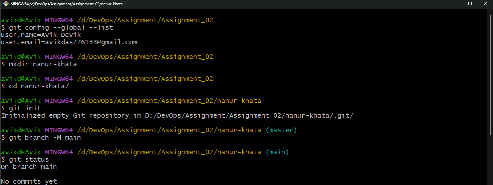
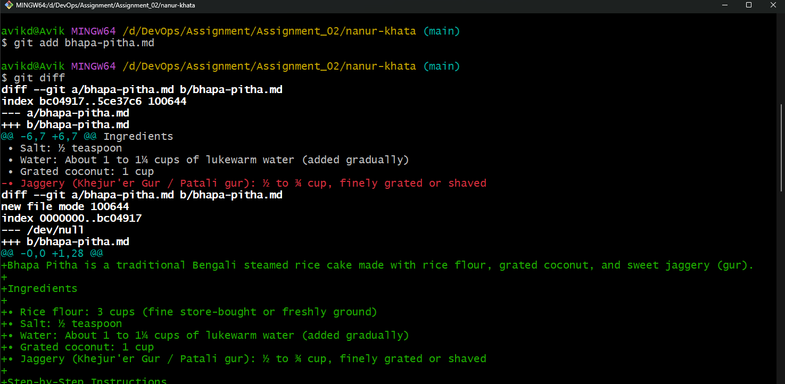
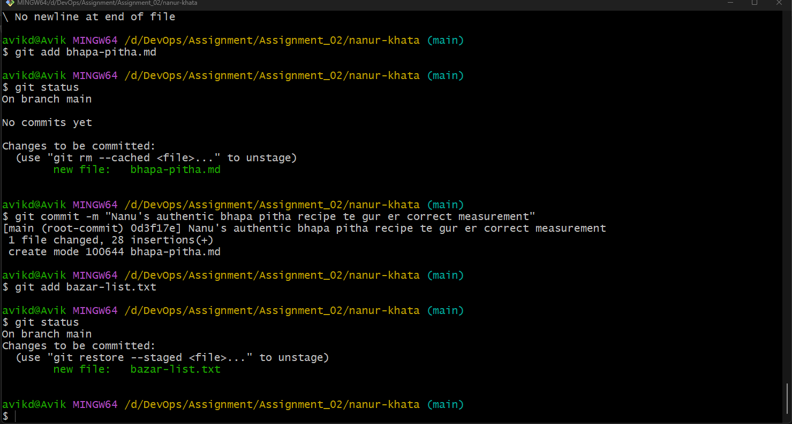

# Nanu's Recipe Book: My Git Journey

Nanu's old recipe book was tearing apart, so my cousin Mitu (in Chattogram) and I digitized it using Git to make sure no family recipe is ever lost.

---

## Chapter 1: The First Recipe
Nanu asked me to start with her winter *bhapa pitha* recipe. I initialized `nanur-khata`, staged `bhapa-pitha.md`, fixed the *gur* measurement from 2 cups to 1.5 cups, committed it, and unstaged an accidental `bazar-list.txt`.

### Key Commands
```bash
git config --global user.name "Your Name"
git config --global user.email "your.email@example.com"
mkdir nanur-khata && cd nanur-khata
git init
git add bhapa-pitha.md
git diff
git diff --staged
git commit -m "add bhapa pitha recipe with 1.5 cups gur"
git reset bazar-list.txt
```

### Q1: Difference between `git diff` and `git diff --staged`
* **`git diff`**: Shows **unstaged changes** by comparing your working directory against the staging area (e.g., my new edit changing `2 cups` to `1.5 cups` of gur before running `git add`).
* **`git diff --staged`**: Shows **staged changes** ready for the next commit by comparing the staging area against the last commit (`HEAD`).





---

## Chapter 2: The Secret Spice
Nanu warned me that her secret spice blend must never reach GitHub. I created `secret-masala.txt`, `.tmp` files, and a `draft/` folder, and blocked them all using `.gitignore`.

### Key Commands
```bash
# Inside .gitignore:
# secret-masala.txt
# *.tmp
# draft/

git status
git add .gitignore
git commit -m "chore: ignore secret-masala.txt, tmp files, and drafts"
```


---

## Chapter 3: The Eid Special
To test Eid recipes safely, I created the `eid-special` branch and committed `biryani.md` and `shemai.md`. When I switched back to `main`, the files weren't there until I merged `eid-special` into `main`.

### Key Commands
```bash
git branch eid-special
git checkout eid-special
git add biryani.md && git commit -m "feat: add Eid biryani recipe"
git add shemai.md && git commit -m "feat: add Eid shemai recipe"
git checkout main
git merge eid-special
git log --oneline
```

### Q2: How I Created and Resolved a Merge Conflict
1. **Created Conflict:** I edited the sweetener line of `shemai.md` on `main` (`Sugar: 1 cup`) and committed it. Then I switched to `eid-special`, changed the **same line** in `shemai.md` (`Condensed milk: 1/2 tin`), and committed it. Running `git merge eid-special` on `main` triggered a merge conflict.
2. **Resolved Conflict:** I opened `shemai.md`, deleted the conflict markers (`<<<<<<< HEAD`, `=======`, `>>>>>>> eid-special`), kept the final recipe line we wanted, and ran `git add shemai.md` followed by `git commit -m "merge: resolve shemai sweetener conflict"`.


---

## Chapter 4: Mitu Joins In
I pushed the book to GitHub so Mitu could contribute from Chattogram. She cloned the repo, added `chittagong-mezban.md`, and pushed. I synced her first update with `fetch` + `merge`, and her second update with `pull`.

### Key Commands
```bash
git remote add origin https://github.com/YOUR-USERNAME/nanur-khata.git
git push -u origin main

# Mitu's side:
git clone https://github.com/YOUR-USERNAME/nanur-khata.git mitu-folder
git add chittagong-mezban.md && git commit -m "feat: add Chattogram mezban recipe"
git push origin main

# My side:
git fetch origin
git merge origin/main
git pull origin main
```

### Q3: What is the difference between `fetch + merge` and `pull`?
* **`git fetch` + `git merge`**: `git fetch` downloads new changes from GitHub into `origin/main` **without** changing your local working files, letting you review them first before running `git merge`.
* **`git pull`**: Automatically runs `git fetch` and `git merge` together in one command, immediately updating your local branch and working directory.


---

## Chapter 5: Half-Cooked Halua and Time Travel
While writing `halua.md`, Nanu reminded me to add cardamom to the biryani. I stashed the unfinished halua, fixed `biryani.md`, and popped the stash back. Later, I organized recipes with `git mv`, deleted an old file with `git rm`, inspected a commit with `git show`, and tested `git reset --hard` on a `test` branch.

### Key Commands
```bash
git stash
git add biryani.md && git commit -m "fix: add cardamom to biryani"
git stash pop
git add halua.md && git commit -m "feat: complete halua recipe"

git mv bhapa-pitha.md shemai.md halua.md desserts/
git rm old-recipe.md
git commit -m "refactor: organize recipes and remove old recipe"
git log --stat -M
git show HEAD

# Time travel on a test branch:
git checkout -b test-branch
git reset --hard HEAD~1
```
**What I lost with `reset --hard`:** The last commit and all uncommitted changes in my working directory on `test-branch` were permanently deleted.

### Q4: Why are `rebase` and `reset --hard` dangerous on a shared branch?
Both commands **rewrite commit history**:
* **`git reset --hard`** permanently erases commits and local work. If force-pushed to a shared branch, it deletes teammates' work on the remote repo.
* **`git rebase`** replaces existing commits with brand-new commit SHA hashes.
* If you rewrite history on a branch that teammates (like Mitu) have already pulled, their local history will conflict with the remote history, causing broken merges and duplicate commits when they pull or push.

---

## Final Git Graph
```bash
git log --oneline --graph --all
```

